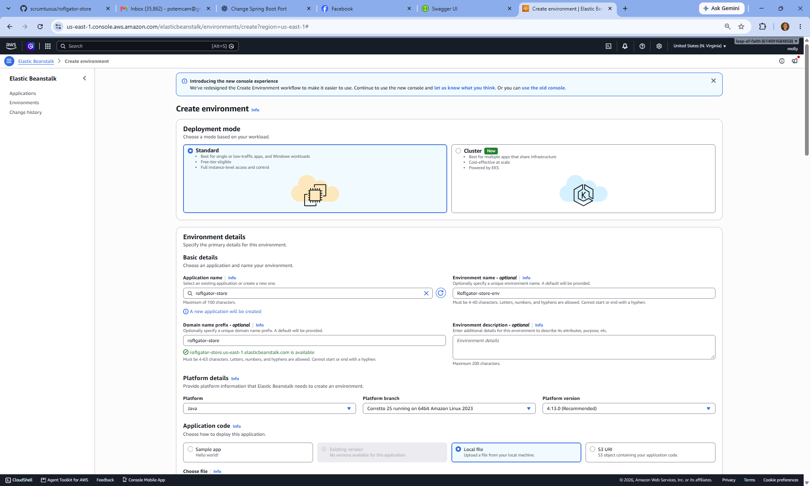
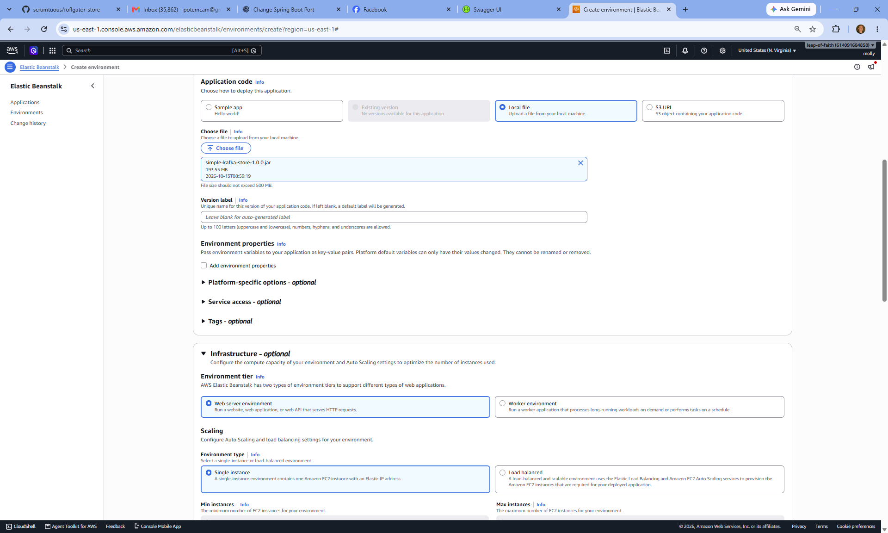
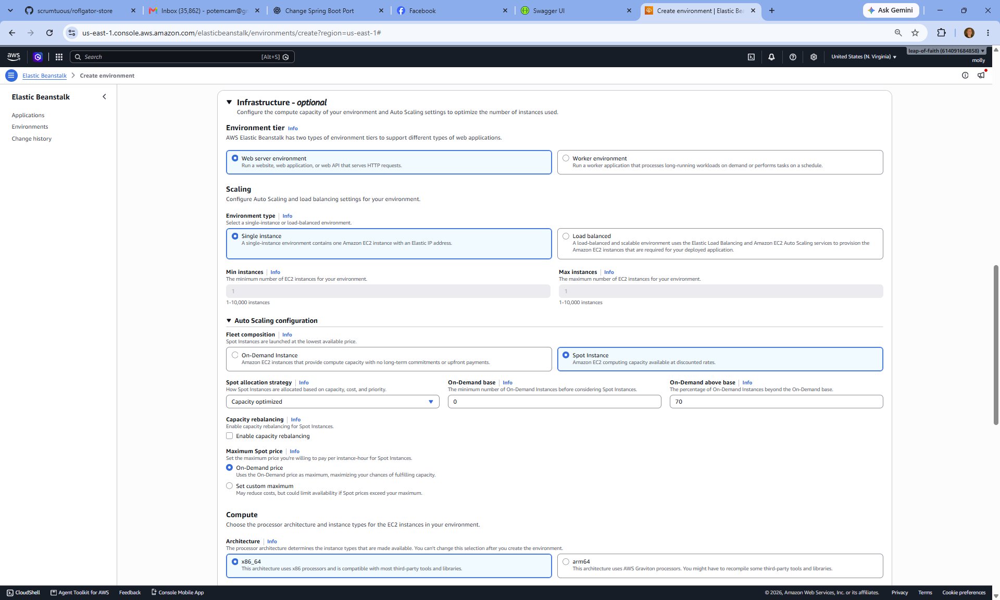
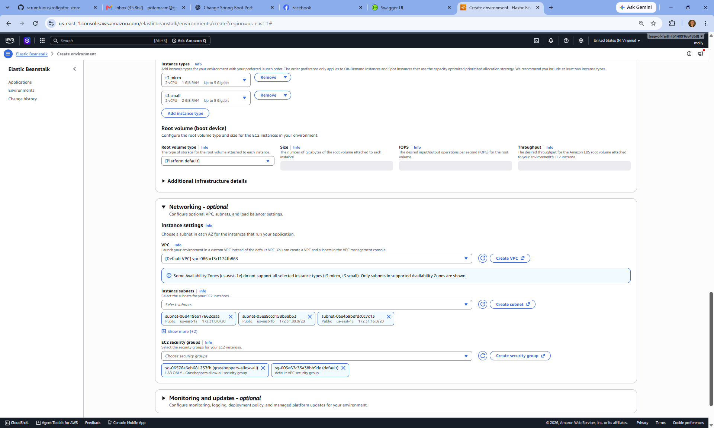

# Deploy your Spring Boot application to AWS Elastic Beanstalk

In this lab, you will upload your application, run it on a Spot Instance, test its public URL, and create a Route 53 A record for your own hostname.

**Replace `roflgator` with your own name throughout the configuration.**

## 1. Build your application

From the project directory containing `pom.xml`, run:

```bash
mvn clean package
```

Confirm that the build finishes successfully. Your deployable JAR will be inside `target`.

The screenshots use:

```text
target/simple-kafka-store-1.0.0.jar
```

Upload the executable `.jar` file, not a `.jar.original` file.

Before deploying, check that your AWS configuration uses your own database name, database connection details, and Kafka address. Once deployed, `localhost` refers to the Beanstalk instance.

## 2. Create the environment

Open **Elastic Beanstalk** in the AWS console and select **US East (N. Virginia), `us-east-1`**, matching the screenshots.

Choose **Create environment**, then select **Standard** deployment mode.

Use your own name for these fields:

| Field | Screenshot example | Your value |
|---|---|---|
| Application name | `roflgator-store` | `yourname-store` |
| Environment name | `Roflgator-store-env` | `yourname-store-env` |
| Domain name prefix | `roflgator-store` | `yourname-store` |

For example, a student named Cameron could use `cameron-store`.

Use letters, numbers, and hyphens. Avoid spaces, and do not begin or end the name with a hyphen. Check that your domain prefix is available.



## 3. Choose the Java platform and upload your JAR

Under **Platform details**:

- Select **Java**.
- Choose a Corretto platform compatible with the Java version used to build your application.
- Use the recommended platform version for that branch.

The first screenshot shows **Corretto 25 running on 64bit Amazon Linux 2023**. Confirm compatibility with your project before copying that selection.

Under **Application code**, select **Local file**, then upload the JAR from `target`.

You can leave the version label blank or enter a label such as `yourname-store-v1`.



## 4. Set the application profile, port, and service access

Under **Environment properties**, select **Add environment properties**.

If your project uses an `aws` Spring profile, add:

| Name | Value |
|---|---|
| `SPRING_PROFILES_ACTIVE` | `aws` |
| `SERVER_PORT` | `5000` |

Use the profile name your project defines.

The Java SE platform's proxy forwards incoming HTTP requests to application port **5000** by default. Setting `SERVER_PORT=5000` aligns Spring Boot with that configuration. You will access the public URL without adding `:5000`.

Add any other environment variables required by your application, including database credentials if your configuration reads them from environment variables.

### Configure service access

Expand **Service access**, choose **Use another role**, and select these existing roles:

| Field | Select |
|---|---|
| Service role | `aws-elasticbeanstalk-service-role` |
| EC2 instance profile | `aws-elasticbeanstalk-ec2-role` |

**Select these existing roles. Do not use automatic role creation for this lab.**

The service role lets Beanstalk manage the environment. The EC2 instance profile supplies AWS permissions to the instance running your application.

If a role is missing or you receive an error saying that you cannot pass the role, report the error so the classroom permissions can be corrected. Choosing the all-access security group does not fix IAM role permissions.

## 5. Configure a single Spot Instance

Under **Infrastructure**, select:

| Setting | Selection |
|---|---|
| Environment tier | **Web server environment** |
| Environment type | **Single instance** |
| Minimum instances | `1` |
| Maximum instances | `1` |
| Fleet composition | **Spot Instance** |
| Spot allocation strategy | **Capacity optimized** |
| On-Demand base | `0` |
| On-Demand above base | **`0`** |
| Maximum Spot price | **On-Demand price** |
| Architecture | **x86_64** |

**Change the screenshot's On-Demand above base value from `70` to `0`.** For a single-instance Spot environment, both On-Demand settings should be zero.

We use **Spot Instances to save money**. Spot Instances use spare EC2 capacity at discounted rates. AWS can interrupt them, so your application may temporarily become unavailable while replacement capacity is obtained.

The **On-Demand price** option under Maximum Spot price is a price ceiling. It does not change your selected fleet composition to On-Demand.



## 6. Select instance types

The fourth screenshot includes:

- `t3.micro`
- `t3.small`

Use these classroom-approved options if available. Providing multiple eligible types gives AWS more capacity options.

Leave the root volume settings at their platform defaults unless your lab requires something different.

## 7. Configure networking and the security group

Under **Networking**:

1. Select the classroom VPC. The screenshot uses the default VPC.
2. Select public subnets that support your chosen instance types.
3. Ensure the instance will have a public IP address for browser access.
4. Under **EC2 security groups**, select **`grasshoppers-allow-all`**.

**The required all-access classroom security group is `grasshoppers-allow-all`.** Selecting only the `default` group does not match this lab.

The screenshot includes both groups. Confirm that `grasshoppers-allow-all` appears among your selections. Security groups belong to a particular VPC, so if it is missing, check your VPC selection.

Your application must also be able to reach its PostgreSQL database and Kafka broker. The security group on the application instance does not automatically configure access on those destination services.



## 8. Create and monitor the environment

Review your settings, then choose **Create environment**.

Watch the environment's **Events** and **Health** sections while AWS provisions the resources and starts the application.

If deployment fails, inspect the events and request application logs. Check the specific error before creating another environment.

| Symptom | What to check |
|---|---|
| Unable to assign or pass a role | Existing role selections and the deploying user's `iam:PassRole` permissions |
| Failed to create the instance profile automatically | Choose **Use another role** and select the existing EC2 instance profile |
| `502 Bad Gateway` | Application startup and `SERVER_PORT=5000` |
| Java version error | Build Java version and selected Corretto branch |
| Database connection failure | AWS profile, hostname, database name, credentials, and network access |
| Kafka connection failure | Broker address, advertised listeners, and network access |
| Instance launch failure | Spot capacity, eligible instance types, permissions, and quotas |

If the AWS profile unexpectedly starts embedded Kafka, an additional configuration change may be needed to disable it for that profile. Address that if it occurs.

## 9. Test the Beanstalk URL first

Copy the domain shown on your environment's overview page.

For the prefix shown in the screenshot, the base testing URL is:

```text
http://roflgator-store.us-east-1.elasticbeanstalk.com
```

With your own prefix, use:

```text
http://yourname-store.us-east-1.elasticbeanstalk.com
```

**Use the address AWS displays if it differs from this pattern.**

If your application exposes Swagger UI at the standard Springdoc path, test:

```text
http://yourname-store.us-east-1.elasticbeanstalk.com/swagger-ui/index.html
```

Open Swagger UI and execute an API request. Check that a database-backed request succeeds, and test an operation that uses Kafka if your application includes one.

A `404` at `/` can simply mean your application has no homepage. Test a defined API endpoint before concluding that deployment failed.

Use **HTTP** for this initial setup. HTTPS requires additional certificate and server configuration.

## 10. Create your Route 53 A record after testing

**Complete and test your Beanstalk deployment before creating the DNS record.**

Once the Beanstalk URL works, create a custom hostname using an **A record with Alias enabled**.

In **Route 53**:

1. Open **Hosted zones**.
2. Select your assigned domain's public hosted zone.
3. Choose **Create record**.
4. Enter your record name, such as `yourname-store`.
5. Select **A** as the record type.
6. Turn **Alias** on.
7. Select **Alias to Elastic Beanstalk environment**.
8. Choose **US East (N. Virginia)**.
9. Select your own Beanstalk environment.
10. Use **Simple routing** and create the record.

For an assigned domain of `example.com`, your new testing URL would be:

```text
http://yourname-store.example.com/swagger-ui/index.html
```

Substitute your assigned domain and the endpoint you successfully tested earlier.

Choose the Beanstalk environment as the alias target instead of copying an EC2 instance's current IP address. The alias follows the environment's address changes.

Allow time for DNS updates, then repeat the same API tests through your custom hostname. Creating the DNS record does not enable HTTPS.

## 11. Deploy future updates

After changing your code, run:

```bash
mvn clean package
```

Open your existing Beanstalk environment and choose **Upload and deploy**. Upload the updated JAR and give it a new version label.

When the lab environment is no longer needed, terminate it through Elastic Beanstalk to stop its ongoing resource usage. Remove the custom DNS record if it is no longer needed.

## Completion checklist

- [ ] Replaced `roflgator` with my own name.
- [ ] Uploaded the executable JAR.
- [ ] Selected the appropriate Java platform and AWS profile.
- [ ] Set `SERVER_PORT` to `5000`.
- [ ] Chose **Use another role**.
- [ ] Selected `aws-elasticbeanstalk-service-role`.
- [ ] Selected `aws-elasticbeanstalk-ec2-role` as the EC2 instance profile.
- [ ] Selected **Spot Instance** with both On-Demand values set to `0`.
- [ ] Selected the **`grasshoppers-allow-all`** security group.
- [ ] Tested the Beanstalk URL and an application request.
- [ ] Created the Route 53 **A alias record** after testing.
- [ ] Tested the custom hostname.

## AWS documentation

- [Java SE proxy configuration](https://docs.aws.amazon.com/elasticbeanstalk/latest/dg/java-se-nginx.html)
- [Managing On-Demand instances and Spot Instances](https://docs.aws.amazon.com/elasticbeanstalk/latest/dg/environments-cfg-autoscaling-spot-and-demand.html)
- [Beanstalk service roles and instance profiles](https://docs.aws.amazon.com/elasticbeanstalk/latest/dg/concepts-roles.html)
- [Managing Beanstalk instance profiles](https://docs.aws.amazon.com/elasticbeanstalk/latest/dg/iam-instanceprofile.html)
- [Routing traffic to a Beanstalk environment with Route 53](https://docs.aws.amazon.com/Route53/latest/DeveloperGuide/routing-to-beanstalk-environment.html)
